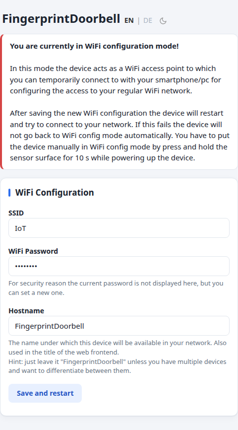
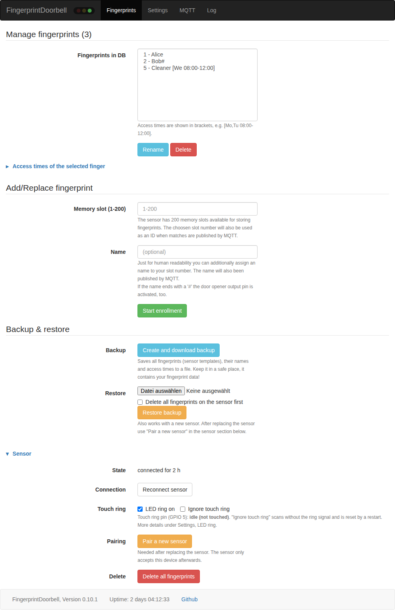
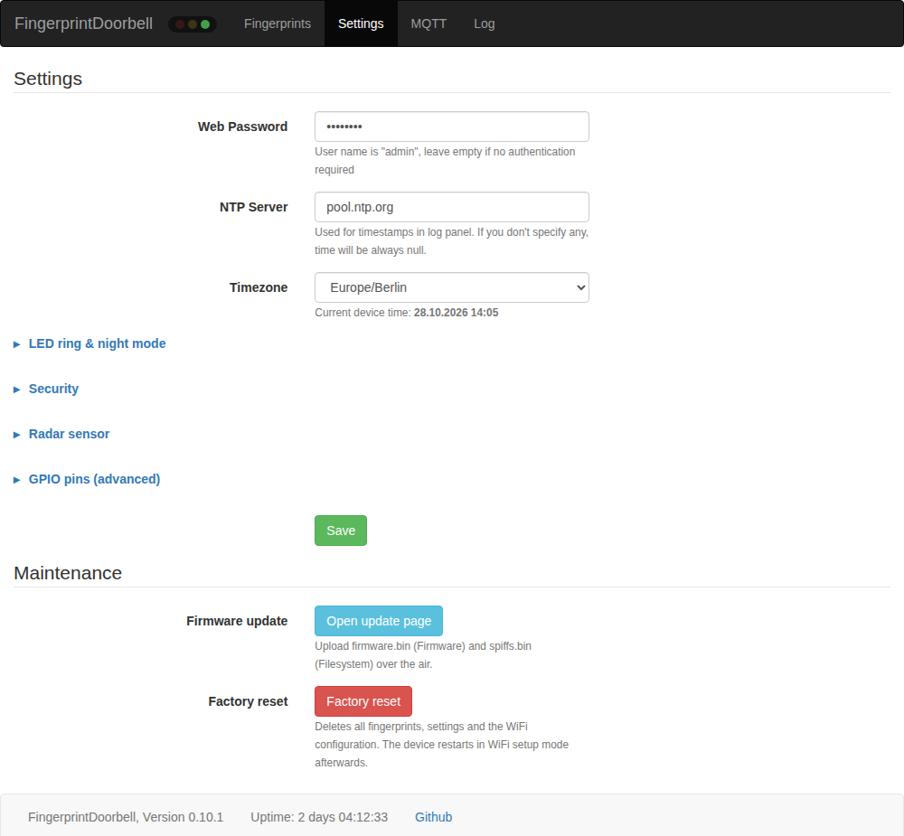
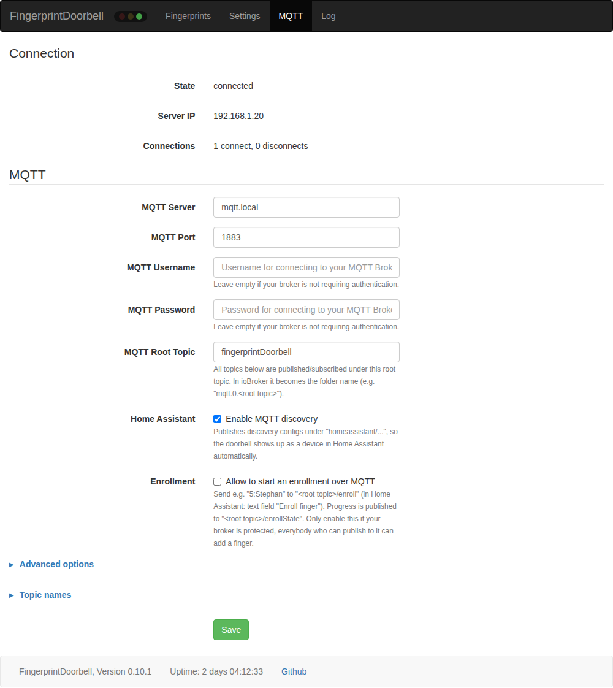
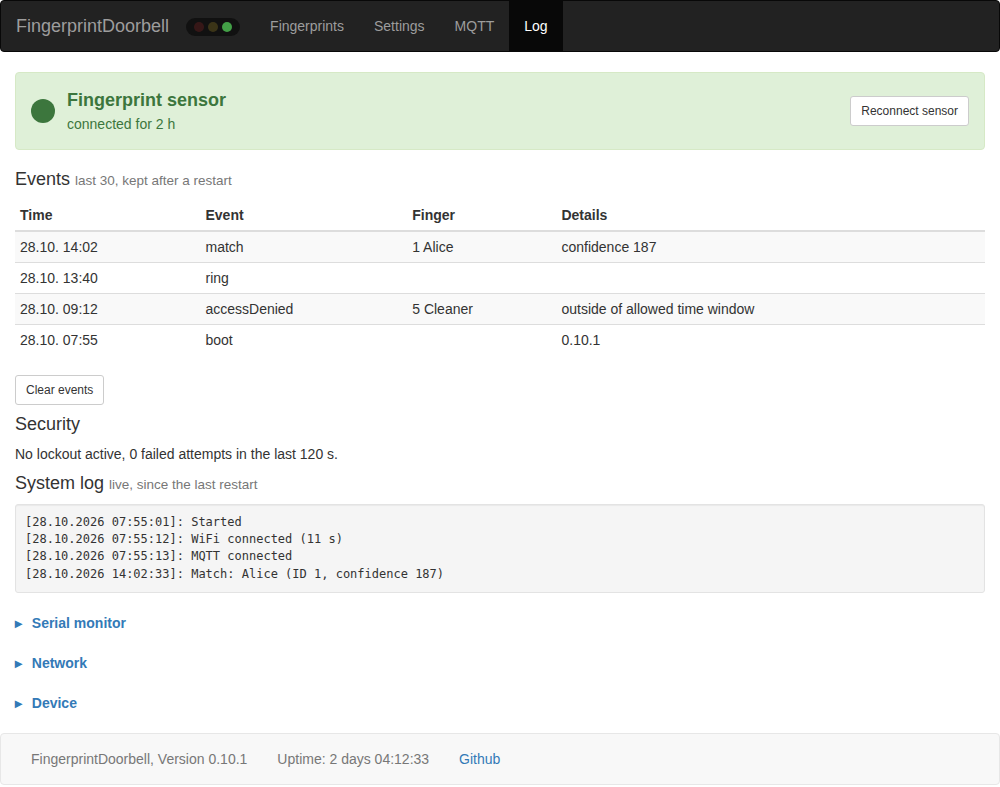

# FingerprintDoorbell

Fork from https://github.com/frickelzeugs/FingerprintDoorbell with some updates

~~OTA-Firmware upload with (Async) ElegantOTA not working because of library incompabilities~~ <- using ESPAsyncHTTPUpdateServer now

Changes from TheMaskedDeveloper:
- color and sequenze configurable in web interface 
- MQTT port configurable
- color for scan/match configurable in web interface

Other changes:
- Web password configurable
- Timezone configurable
- Uptime in status bar
- door opener pin on GPIO 23, triggerable with MQTT
- MQTT last will testament
- Status web site with lots of info
- OTA with ESPAsyncHTTPUpdateServer

Changes in 0.6:
- Home Assistant MQTT discovery (can be disabled in settings)
- LED ring can be switched off over MQTT (`ledRing` on/off, e.g. at night), feedback while scanning is still shown
- state of `ignoreTouchRing` and `ledRing` is published to `.../state` topics
- fix: OTA update page was reachable without password, `/reboot` was not protected
- fix: random DNS requests (e.g. visible in Pi-hole) caused by a dangling NTP server pointer
- fix: timezone setting was not saved
- timezone selectable from a list (e.g. "Europe/Berlin"), invalid values fall back to CET/CEST instead of silently using UTC (time was off by 1-2 hours), current device time shown in settings
- fix: special characters (e.g. `%`, `"`) in passwords/names broke the settings page
- fix: MQTT broker hostname is resolved again on every reconnect (no more lost MQTT if DNS was not ready at boot)
- fix: MQTT login with username but empty password
- fix: enrollment could hang forever if the finger was not lifted
- MQTT password is masked in the settings page, settings forms use POST (no passwords in URLs)
- web pages use the local bootstrap.min.css instead of a CDN (works without internet)
- separate "MQTT" page in the web UI, all MQTT topics configurable there (collapsed sections "Advanced options" / "Topic names"), plus port, client id, keepalive, on/off payloads (e.g. true/false for ioBroker), retain flag and log publishing
- connection diagnostics: reason of MQTT/WiFi connection losses in the log, counters on the system page

Changes in 0.7:
- **Backup & restore** of all fingerprints (sensor templates, names, access times) as a file, also to a new sensor
- **Access times per finger** (weekdays + time window, or disabled); outside the window "accessDenied" is published instead of a match
- **Protection against trying out fingers**: lockout after a configurable number of failed attempts within a time window; configurable **ring cooldown**
- **Event history** (last 30 events, kept after a restart) and a live system log on the new "Log" page
- **Night mode**: idle LED ring off between two times
- **Radar sensor** (e.g. HLK-LD2410) on a configurable GPIO: presence to MQTT/HA, optionally LED ring only on when somebody is near the door
- **Enrollment over MQTT / Home Assistant** (optional, disabled by default)
- many more values in Home Assistant: WiFi signal, uptime, IP, stored fingerprints, failed attempts, lockout, last event, ...

Changes in 0.7.1:
- faster web UI: stylesheet is stored gzip compressed and cached by the browser (19kB once instead of 121kB on every page), WiFi modem sleep disabled (it added 100-300ms latency per packet), no blocking DNS lookup on the system page
- settings and MQTT settings are applied immediately, no reboot anymore

Changes in 0.7.2:
- fast boot: the device doesn't wait for WiFi anymore. Before, it rebooted after 30s without WiFi connection, which could end in a reboot loop of several minutes. Now the sensor, doorbell and web server start immediately, WiFi connects in the background (retried every 20s) and MQTT connects as soon as WiFi is up. The doorbell output also works without WiFi.
- log shows the boot time and after how many seconds WiFi was connected
- web server (incl. update page) is always started, even if the file system is damaged

Changes in 0.7.3:
- WiFi: scans and connects to the strongest access point of the configured network (helps with multiple APs / mesh), every second retry restarts the WiFi stack
- WiFi disconnect reason (e.g. "15 4-way handshake timeout") in the log and on the system page

Changes in 0.8.0:
- **Fingerprint sensor supervision**: the sensor is checked every 10s. If it does not answer (cable/power problem) it is reported as lost in the log, event history, on the system page and over MQTT (`info/sensor` = online/offline, `info/sensorLost` = counter, Home Assistant entity "Fingerprint sensor"). While it is missing, the device keeps running and tries to reconnect every 15s for 3 minutes without a reboot (afterwards only the manual "Reconnect sensor" button on the System page reconnects it); after reconnecting the LED ring is restored and the sensor pairing is checked again.
- **Traffic light** next to the device name in the top bar of every page: green = sensor ok, yellow = sensor does not answer / reconnecting, red = not connected (tooltip shows details, updates every 3s).
- **"Reconnect sensor" button** on the System page: restarts the sensor serial port and connects again without rebooting the ESP32 (also available as `POST /sensor/reconnect`; status as JSON on `GET /sensor/status`).

Changes in 0.10.1:
- **Serial monitor** on the Log page: everything the firmware writes to the serial port (last 8 KB, each line with the time since boot) can be read in the browser without a USB cable (`GET /serial/log`, protected by the web password like the other pages). Output of the boot loader before the firmware starts and ESP-IDF system messages are not included.

Changes in 0.10.0:
- **GPIO pins configurable** (Settings, "GPIO pins"): sensor RX/TX, touch ring, doorbell output and door opener output. Only pins that really work for the function are offered (classic ESP32: no strapping pins, no flash pins, no USB serial pins, no input-only pins for outputs); a pin can only be used once, also not together with the radar pin. The pins are used after a restart; invalid stored pins fall back to the original wiring (RX 16, TX 17, touch 5, doorbell 19, door opener 23).

Changes in 0.9.1 (diagnosis of the touch ring):
- Settings page, "LED ring & night mode": live view of how the LED ring should look right now (color, breathing/blinking/steady/off, and the reason, e.g. night mode or lockout), the state of the touch ring wake-up pin (GPIO 5, "idle"/"touched") and two switches "LED ring on" and "Ignore touch ring" (also in the "Sensor" section of the Fingerprints page) that work without MQTT (`POST /sensor/ring`, state in `GET /sensor/status`)

Changes in 0.9.0 (web UI cleanup):
- menu is now Fingerprints / Settings / MQTT / Log, the System page is merged into the Log page (`/system` redirects to `/log`)
- Log page: large fingerprint sensor status with "Reconnect sensor" button at the top, network and device info as collapsible sections at the bottom
- the log panel at the top of the Fingerprints, Settings and MQTT pages is gone; on the Fingerprints page a status box only appears while an action runs (enrollment, rename, delete, ...)
- Fingerprints page: new collapsible "Sensor" section with sensor state, reconnect, "Pair a new sensor" and "Delete all fingerprints" (moved from Settings)
- Settings page: "Advanced Actions" renamed to "Maintenance" (firmware update, factory reset), one row with description per action
- MQTT page: connection state, broker IP and connection counters at the top
- Settings and MQTT pages no longer open a live event connection to the device

## What is FingerprintDoorbell?
A doorbell that can read fingerprints, or a fingerprint reader that can work as a doorbell, depending on how you look at it. An ESP32 drives a Grow R503 fingerprint sensor:

- **Unknown finger** (or just a touch on the ring): it rings. The `ring` topic is published over MQTT and the doorbell output is switched on for a moment.
- **Known finger**: the finger ID, name and confidence are published over MQTT. Your home automation (Home Assistant, ioBroker, openHAB, ...) can then open the door or unlock a smart lock. A finger whose name ends with `#` also switches the door opener output directly.

Everything is set up in a web interface. No cloud and no internet connection are needed.


## Features
- up to 200 fingerprints with names, **access times per finger** (weekdays and time window, or disabled)
- **backup and restore** of all fingerprints as a file, also onto a new sensor
- **brute force protection**: lockout after too many failed attempts, ring cooldown
- **night mode** and an optional **radar presence sensor** (e.g. HLK-LD2410) to switch the LED ring off when nobody is near the door
- MQTT with freely configurable topics and on/off payloads, **Home Assistant MQTT discovery**, enrollment over MQTT/Home Assistant
- **event history** (last 30 events, kept after a restart), live system log and a serial monitor in the browser
- **sensor supervision**: a lost sensor is reported and reconnected without a reboot, traffic light in the top bar of every page
- sensor pairing: a replaced sensor is detected, so nobody can connect their own sensor with their own fingers
- configurable GPIO pins, firmware update over the air (OTA)

# Hardware
## What do I need?
- Grow R503 fingerprint sensor
- an ESP32 board, e.g. ESP32 DevKit V1 or an ESP32 mini (classic ESP32 with ESP32-WROOM-32)
- optional: an HLK-LD2410 radar sensor for presence detection

## Wiring


Default pins (they can be changed in the web interface under Settings, "GPIO pins (advanced)"):

| Function | ESP32 GPIO |
| --- | --- |
| Sensor TX (ESP32 receives) | 16 |
| Sensor RX (ESP32 sends) | 17 |
| Touch ring / wake-up signal | 5 |
| Doorbell output | 19 |
| Door opener output | 23 |
| Radar sensor OUT (optional) | 32 |

I would not solder the cables directly to the ESP32, but use a connector between ESP32 and sensor. Otherwise the cables have to go through the 25 mm hole for the sensor before soldering, and replacing the sensor becomes a pain. The original plug of the sensor is a 6-pin Micro JST SH 1.00 mm, but any other 6-pin connector works if you replace both sides.

As an inspiration, a small shield board for the ESP32 mini with a JST socket, a DC-DC step-down converter and screw terminals for the power supply:


**Ground the sensor housing!** Otherwise touching the sensor while you are electrostatically charged can cause restarts or even damage the ESP32.

### Radar sensor (optional)
An HLK-LD2410 can be connected directly: VCC to 5V, GND to GND and OUT to a free GPIO (default 32, selectable in the settings). OUT uses 3.3V logic, no level shifter needed. Sensitivity and range are set with the HLKRadarTool app (Bluetooth versions LD2410B/C). Enable it under Settings, "Radar sensor".

# Flashing the firmware
Two images are needed: `firmware.bin` (the program) and `spiffs.bin` (the web interface). Ready-made files are attached to the [releases](https://github.com/Kalored/FingerprintDoorbell-geronet1/releases/latest), or build them yourself.

## Build with PlatformIO
* Install [Visual Studio Code with the PlatformIO extension](https://platformio.org/platformio-ide) (or the PlatformIO command line tools).
* Clone this repository and open it.
* Build: `pio run` creates `firmware.bin`, `pio run -t buildfs` creates `spiffs.bin` (in VS Code: Project Tasks, esp32doit-devkit-v1, General, Build and Platform, Build Filesystem Image).
* First installation over USB: `pio run -t upload` and `pio run -t uploadfs` (Upload and Upload Filesystem Image).

## Flash binaries with esptool
Install esptool with `pip install esptool`. You need the boot loader files from [doc/bootloader.zip](doc/bootloader.zip) (`bootloader_dio_40m.bin`, `boot_app0.bin`, `partitions.bin`) plus `firmware.bin` and `spiffs.bin` from the [latest release](https://github.com/Kalored/FingerprintDoorbell-geronet1/releases/latest). Put all five files in one folder and run there:

```
esptool.py --chip esp32 --baud 460800 --before default_reset --after hard_reset write_flash -z --flash_mode dio --flash_freq 40m --flash_size detect 0x1000 bootloader_dio_40m.bin 0x8000 partitions.bin 0xe000 boot_app0.bin 0x10000 firmware.bin 0x290000 spiffs.bin
```

The [web flasher of the upstream project](https://geronet1.github.io/FingerprintDoorbell-flasher/) also works for the first installation. It installs the older upstream version; update to this version afterwards over the air.

After flashing, the LED ring breathes red: the device is in WiFi configuration mode.

## Updates over the air
Settings, "Maintenance", "Open update page": upload `firmware.bin` as "Firmware" and `spiffs.bin` as "Filesystem". Always update both, the web pages belong to the firmware version.

# Configuration
## WiFi
Without WiFi settings (first start, after a factory reset) the device starts in WiFi configuration mode (LED ring breathing red) and opens its own access point **"FingerprintDoorbell-Config"**, password **"12345678"**. Connect to it; the configuration page opens as a captive portal, otherwise browse to http://192.168.4.1.



Enter SSID, password and host name and save. The device restarts and connects to your network. The web interface is then available at http://fingerprintdoorbell (or the host name you chose).

The device never goes back to configuration mode on its own, even if the WiFi is unavailable; it keeps trying to connect. To enter configuration mode again, keep your finger on the sensor while powering up the device.

## Web interface
The menu has four pages. The traffic light next to the device name shows the state of the fingerprint sensor on every page (green ok, yellow does not answer / reconnecting, red not connected).

### Fingerprints


- **Manage fingerprints**: rename or delete fingers, set **access times** of the selected finger (always, only on certain weekdays/times, or disabled). Outside the allowed times the finger is rejected and `accessDenied` is published instead of a match.
- **Add/Replace fingerprint**: choose a memory slot (1-200, also used as ID in MQTT) and an optional name, then "Start enrollment". Place and lift your finger 5 times; the status box at the top tells you what to do. Don't vary the position too much, otherwise the 5 scans cannot be combined.
- **Backup & restore**: downloads all fingerprints (sensor templates), names and access times as a file and restores them, also onto a new sensor. Keep the file safe, it contains your fingerprint data.
- **Sensor**: sensor state, reconnect, LED ring and touch ring switches, "Pair a new sensor" and "Delete all fingerprints".

### Settings


Web password (user name "admin"), NTP server and time zone, and in collapsible sections: LED ring colors and night mode (with a live view of the ring and the touch ring pin), security (failed attempts, lockout time, ring cooldown), radar sensor and GPIO pins. Saving does not restart the device, except new GPIO pins, which are used after a restart. "Maintenance" holds the firmware update and the factory reset.

### MQTT


Connection state, broker settings, root topic, Home Assistant discovery and enrollment over MQTT. Under "Advanced options": client ID, keepalive, on/off payloads (e.g. `true`/`false` for ioBroker), retain and log publishing. Under "Topic names": every sub topic.

**The client ID must be unique on your broker.** Two devices with the same client ID kick each other off the broker every few seconds.

### Log


Large sensor state with reconnect button, event history (last 30 events, kept after a restart), lockout state, live system log, a serial monitor (everything the firmware writes to the serial port, no USB cable needed) and network/device information (IP, WiFi, RSSI, connection losses, MQTT, chip, memory, reset reason).

# MQTT
The root topic (default `fingerprintDoorbell`), all sub topics below and the on/off payloads can be changed on the MQTT page. Defaults:

| Topic | Direction | Values |
| --- | --- | --- |
| LWT | publish (retained) | `Online` / `Offline` |
| ring | publish | `on` for 1 s on a ring event, otherwise `off` |
| matchId | publish | ID of the matching finger for 3 s, otherwise `-1` |
| matchName | publish | name of the matching finger for 3 s |
| matchConfidence | publish | confidence of the match (1-400, higher is better) for 3 s |
| lastLogMessage | publish | last log message (can be disabled) |
| ignoreTouchRing/state | publish (retained) | `on` / `off` |
| ledRing/state | publish (retained) | `on` / `off` |
| openDoor | subscribe | `true` switches the door opener output |
| ignoreTouchRing | subscribe | `on` / `off`, see FAQ |
| ledRing | subscribe | `on` / `off`, idle light of the LED ring (feedback while scanning is still shown) |

Fixed topics below the root topic:

| Topic | Direction | Values |
| --- | --- | --- |
| lockout | publish (retained) | `on` / `off`, too many failed attempts |
| accessDenied | publish (retained) | name of a rejected finger (lockout, access times), empty after 3 s |
| lastEvent | publish (retained) | last entry of the event history |
| nightMode | publish (retained) | `on` / `off` |
| presence | publish (retained) | `on` / `off`, radar sensor (only if enabled) |
| info/rssi, info/uptime, info/ip, info/freeHeap, info/fingerCount, info/failedAttempts, info/wifiLost, info/mqttLost, info/version, info/sensor, info/sensorLost | publish (retained, every 60 s) | diagnostic values |
| enroll | subscribe | `5:Name` starts an enrollment for slot 5 (only if enabled on the MQTT page) |
| enrollState | publish (retained) | `idle` / `running` / `step n/5` / `success` / `failed` |

## Home Assistant
With "Enable MQTT discovery" (default) the doorbell shows up as a device in Home Assistant with entities for ring, match ID/name/confidence, access denied, lockout, failed attempts, last event, last log message, night mode, presence, enrollment (text field and state), the switches "LED ring" and "Ignore touch ring", the button "Open door" and diagnostic values (WiFi signal, uptime, IP address, free memory, stored fingerprints, fingerprint sensor state, connection losses). Unchecking the option removes the entities again.

# Security
- **Sensor pairing**: ESP32 and sensor are paired. If the sensor is replaced (e.g. by an attacker with their own fingers stored on it), the pairing becomes invalid and no more match events are published, even if the old sensor is connected again. Ringing still works. If you replaced the sensor yourself, use "Pair a new sensor" in the Sensor section of the Fingerprints page.
- **Lockout**: after too many failed attempts in a time window (Settings, "Security") fingers are rejected for a while, the ring breathes red and `lockout` is published.
- **Web password**: protects all pages, the update page and the serial monitor (user "admin").
- **Factory reset** deletes all fingerprints, settings and the WiFi configuration. The device restarts in WiFi configuration mode.

# FAQ
## What do the colors of the LED ring mean?
Idle, scan and match colors can be changed in the settings; the table shows the defaults.

| Color | Sequence | Meaning |
| --- | --- | --- |
| blue | breathing | ready, waiting for a touch (idle color/sequence configurable) |
| blue | steady | ready, touch ring is ignored |
| off | | LED ring switched off, night mode, or nobody near the door (radar) |
| blue | flashing | sensor connected at startup |
| red | flashing | finger detected, scanning (scan color) |
| purple | steady | match found (match color); during enrollment: lift your finger |
| purple | flashing | enrollment, place your finger |
| red | 3 short flashes | finger rejected (access times or lockout) |
| red | breathing fast | lockout after too many failed attempts |
| red | breathing slowly | WiFi configuration mode |
| red | steady | error |

## What is "Ignore touch ring" for?
The sensor surface only recognizes a finger if most of it lies on the sensor long enough. Visitors who just want to ring often only touch it briefly, so the doorbell also uses the touch signal of the metal ring around the sensor (GPIO 5), which reacts to the slightest touch. This ring is capacitive and, like a smartphone display, rain drops can trigger it: horizontal rain during a storm can ring your doorbell at 3 AM.

Setting `ignoreTouchRing` to `on` (MQTT, Home Assistant switch, or the Sensor section of the Fingerprints page) ignores the ring signal; only a finger on the sensor surface counts then. Let your home automation switch it on when it is raining and windy. The setting is reset by a restart.

## Troubleshooting
- **Sensor not found**: check power and TX/RX (crossed: sensor TX to ESP32 RX). The device keeps running and retries for 3 minutes; afterwards use "Reconnect sensor". The serial monitor on the Log page shows what happens at startup. If you changed the GPIO pins, set the defaults again.
- **Frequent MQTT reconnects**: make sure no other device uses the same MQTT client ID.
- **WiFi takes long to connect with multi-AP systems (e.g. TP-Link Omada)**: the ESP32 only supports 2.4 GHz and WPA2. For its SSID use WPA2-PSK (AES) instead of WPA2/WPA3, disable PMF, 802.11r/fast roaming and band steering. A separate 2.4 GHz IoT SSID works best.
- **Wrong time**: select your time zone from the list in the settings; the current device time is shown below it.
